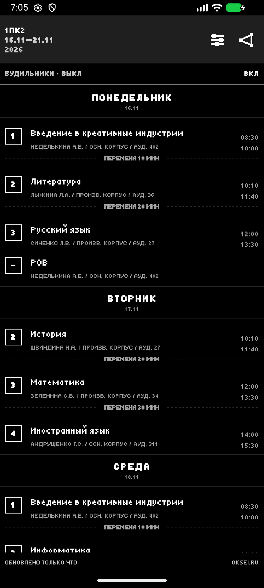
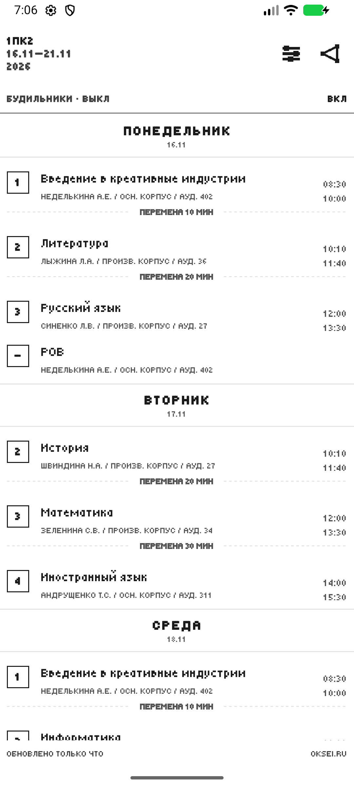
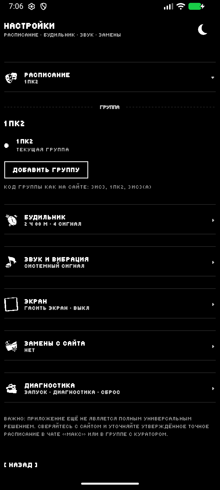

<div align="center">

# Syllabus

**Расписание колледжа ОКЭИ: пары, замены, звонки и будильник к первой паре.**
Один раз загрузили неделю — дальше всё работает без интернета.

[](#требования)
[](#требования)
[](https://github.com/Polusladky/Syllabus/actions/workflows/build.yml)
[](https://github.com/Polusladky/Syllabus/releases/latest)

[](#как-это-устроено)
[](#как-это-устроено)
[](#сборка)
[](https://deepseek.com)

</div>

---

## Скриншоты

| Расписание | Светлая тема | Настройки |
|:---:|:---:|:---:|
|  |  |  |

## Возможности

- **Неделя целиком** — дни с датами, номера пар, время начала и конца, перемены с длительностью.
- **Замены с сайта** — отдельный разбор страницы замен, подсветка изменённых пар.
- **Будильник к первой паре** — за 2 часа до начала, свой звук или системный сигнал, вибрация,
  свайп-ползунки «выключить» и «отложить на 5 минут».
- **Виджеты** — 4×2 и компактный, рисуются вручную шрифтом приложения, без сторонних библиотек.
- **«Сейчас» и «следующая пара»** — отдельные экраны свайпом, с таймером до конца пары.
- **Архив недель** — каждая загруженная неделя сохраняется и открывается без сети.
- **Поделиться** — расписание картинкой или текстом.
- **Тёмная и светлая темы** — монохром, пиксельный шрифт Tiny5, никаких скруглений и теней.
- **Бот MAX** — расписание можно забирать из чата «МАКС» через бота, если сайт недоступен.
- **Диагностика** — проверка парсера, будильников, разрешений и журнала ошибок.

Приложение не тянет за собой AndroidX и Gradle: только фреймворк, свои View и шрифт в assets.
Итоговый APK — около 400 КБ.

## Установка

1. Скачайте APK из [Releases](https://github.com/Polusladky/Syllabus/releases/latest).
2. Установите (Android может попросить разрешить установку из этого источника).
3. При первом запуске укажите группу — код как на сайте колледжа, например `3ИС3`.

**Требования:** Android 5.0 (API 21) и новее.

## Сборка

Нужен Windows 10+ с PowerShell и `curl.exe`. Всё остальное скачивается само:

```powershell
powershell -ExecutionPolicy Bypass -File tools\setup-toolchain.ps1   # JDK 17, build-tools 34, apktool 2.11.1
.\build.ps1
```

Скрипт собирает `patch/fixsrc` в `classes2.dex`, пересобирает smali и ресурсы через apktool,
добавляет вторую dex, выравнивает и подписывает APK. Результат — `dist/okei-schedule-v<версия>.apk`,
лог — `logs/last-run.txt`.

Ключ подписи в репозиторий не входит. Положите свой в `keystore/syllabus.keystore`
и пароль в `keystore/keystore-pass.txt` — или укажите пути параметрами:

```powershell
.\build.ps1 -Keystore D:\keys\my.keystore -KeystorePassFile D:\keys\pass.txt
# то же через переменные окружения: SYLLABUS_KEYSTORE, SYLLABUS_KEYSTORE_PASS_FILE
```

Без ключа соберётся неподписанный APK — для проверки кода этого достаточно.

## Как это устроено

Приложение целиком на **Java**, но хранится в виде **smali** (ассемблер Dalvik) — проект
восстановлен из APK и собирается обратно без Gradle. Новые классы пишутся на **Java 8**
и уходят в `classes2.dex`, сборка и релизы — на **PowerShell 5.1**.


Приложение разбирает вёрстку страницы расписания колледжа в объекты `WeekSchedule`,
`DaySchedule` и `Lesson`, складывает результат в кэш и дальше работает офлайн.
Замены разбираются отдельно и накладываются на неделю. Будильники ставятся через
`AlarmManager` на первую пару дня, звук играет через `MediaPlayer` с `USAGE_ALARM`.

Код приложения хранится в виде smali (`app/`), потому что проект собран из APK.
Новые классы пишутся на Java в `patch/fixsrc/`, компилируются в `classes2.dex` и вызываются
из smali — так проще поддерживать логику, чем править smali руками.

## Структура

```
app/                 smali, ресурсы, AndroidManifest.xml, apktool.yml — то, что собирается в APK
patch/fixsrc/        Java-классы, подключаемые к приложению (компилируются в classes2.dex)
patch/stubs/         заглушки для компиляции этих классов
tools/               setup-toolchain.ps1 — скачивание JDK, SDK и apktool
build.ps1            сборка APK одной командой
docs/screenshots/    скриншоты для README
```

## Ограничения

- Приложение **не является официальным источником** расписания: данные берутся с сайта колледжа,
  возможны задержки и ошибки разбора. Сверяйтесь с сайтом и уточняйте в чате «МАКС» или у куратора.
- Парсер зависит от разметки сайта: если её поменяют, приложение покажет предупреждение
  «часть пар не распознана» и продолжит работать с тем, что разобрало.
- Проект собирается только на Windows: скрипты сборки — PowerShell.

## Как это сделано

Код, рефакторинг smali, сборка APK и релизы — с помощью
**[DeepSeek Harness (DSH)](https://deepseek.com)** — агента, который живёт в терминале,
сам правит smali, гоняет сборку и раскладывает релизы.

## Лицензия

Отдельной лицензии у кода нет: проект открыт для чтения и личного использования,
но переиспользование и распространение согласуйте с автором.

Шрифт Tiny5 распространяется по SIL Open Font License 1.1 — текст в
`app/assets/fonts/OFL.txt`.
